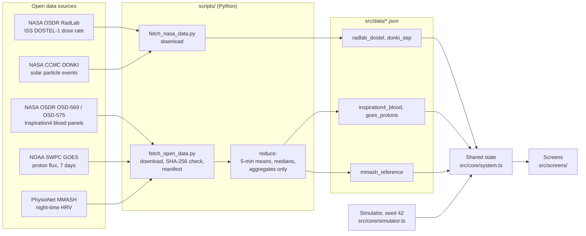
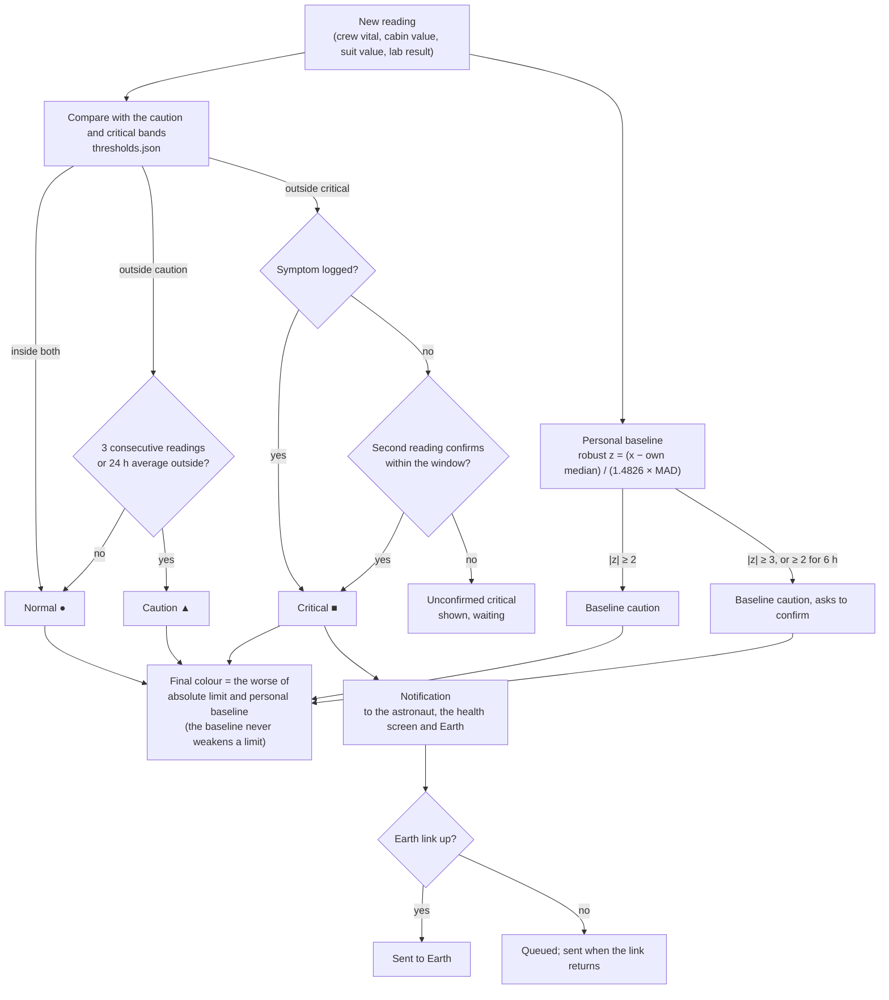
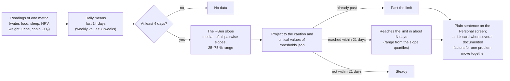
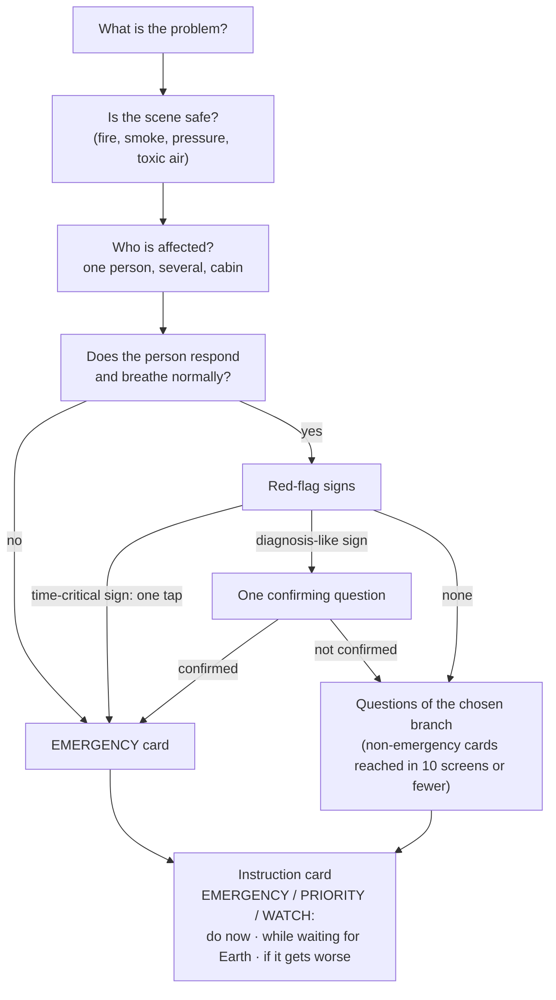
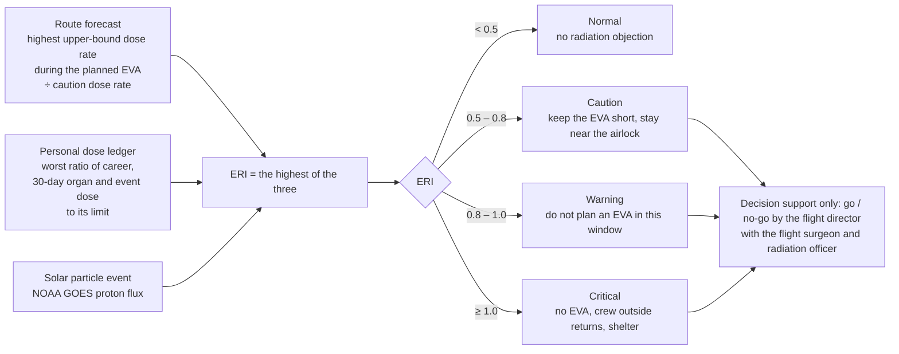

# Astronaut Health Monitor

NASA Space Apps Challenge 2026 · Challenge: *Create Health Monitoring Software for Astronauts on Space Missions* · Team: **Spark**

**Live demo:** https://spark-health-monitor.onrender.com/ (desktop screen, no sign-in) · **Code:** https://github.com/Spark-teams422/spark-health-monitor · **Desktop app:** [download (`app` branch)](https://github.com/Spark-teams422/spark-health-monitor/tree/app)

## Summary

A decision-support tool (not a diagnostic device) that tells a crew far from Earth **who** is affected, **how long** they have and **what to do now**, even when the link to Earth is delayed or lost. Eight views share one data, threshold and notification layer; every alert limit comes from a cited NASA standard or team document, and simulated data is always labelled as such.

## Views

| View | What it shows |
| --- | --- |
| **Main** | One table, numbers only (the team's layout): each astronaut's blood pressure, HRV, SpO₂, body temperature and mental state; cabin CO₂, O₂, pressure, temperature and radiation (current and cumulative); Earth link, clock, mission day and days left; Emergency button. |
| **Personal** | Crew list and the selected astronaut's values (click a value for its 1–24 h history); crew oxygen chart (person or environment?), mission readiness panel (score with its breakdown) and the person's radiation dose ledger, each with a short explanation bubble; health hexagon; sub panels for blood and urine results (1 week to whole mission), alert history and daily check-in (non-urgent health issue log, sleep and symptom diary, nine log types); 3D body you can rotate and zoom. |
| **Tasks & Calendar** | Crew tasks with checkboxes, crew birthdays shared with everyone, private family dates, and Add task / Add event. |
| **Periodic** | The eleven periodic health tasks of one astronaut (eye exam, blood and urine, cognitive test, nutrition, medication, symptom diary, ECG, body mass, fitness, strength, sleep): how, how often, last done, next due / overdue, latest result coloured by its limit, and the history of each value. |
| **Physical** | Bone (urine calcium and NTX against the personal baseline, estimated bone calcium loss), muscle (strength loss, exercise compliance), aerobic fitness and body mass, each opening a history sub panel; the person's weekly Sprint exercise plan, editable. |
| **Cabin** | Cabin values over 1–24 h with their caution / critical bands; crew radiation: each astronaut's career, 30-day organ and solar-event dose against its own limit, career dose over the mission, measured dose rate (NASA OSDR RadLab replay, DONKI events). |
| **EVA** | Nine suit metrics on a black, glove-friendly panel driven by five keys: time budget ("Return by"), O₂ and leak, consumables, suit pressure, inspired CO₂, workload, heat, orthostatic risk (G-TRANSIT), environment. |
| **Emergency** | Acute decision tree: 115 questions leading to 64 instruction cards (do now / while waiting for communication / if it gets worse). |

Status is never colour alone: ● Normal, ▲ Caution, ■ Critical. Type is B612, the typeface Airbus and ONERA designed for cockpit displays; every view fits one desktop screen without scrolling. A confirmed critical value notifies the astronaut, the health screen and Earth; while the link is lost, notifications queue and are sent when it returns.

## How it works

The processing steps, from the raw open datasets to what the crew sees. Each step names the file that does it; limits come from `src/config/thresholds.json`, each with its source.

### 1. From open data to the app

Real datasets are downloaded once by scripts, checked, reduced to small JSON files and shipped with the app. Everything else is simulated (seed 42) and labelled "sample data" on screen.



Individual PhysioNet records never enter the repository: only medians and quartiles by sex and age band are kept.

### 2. From a reading to an alert

Every measurement, real or simulated, goes through the same status engine. Screens only display its result; they never compare a value with a limit themselves (a test checks this).



Status is never shown by colour alone: every level also has a shape and a word (● Normal, ▲ Caution, ■ Critical).

### 3. Early warning: where a value is heading

Daily and weekly values are not alarmed on a trend; the panel only says when a value would reach a limit that already exists if the trend goes on.



No machine-learning model is trained: no open astronaut data links measurements to later health events.

### 4. Emergency: acute decision tree

The Emergency button opens the team's acute decision tree (`src/config/acuteTree.json`): 4 selection screens and 111 yes / no questions leading to 64 instruction cards. Full English text of the source document: [docs/acute-decision-tree-v3.md](docs/acute-decision-tree-v3.md).



### 5. Spacewalk radiation risk

Before and during an EVA, the Cabin Radiation view combines three ratios into one EVA radiation risk index (ERI).



## Run

Requires Node.js 20.19+ or 22.12+.

```bash
npm install
```

```bash
npm run dev
```

Open http://localhost:5173 (on macOS you can also double-click `Astronaut Health Monitor.command`). A welcome window asks you to choose a scenario and starts it; you can change it any time in the **Scenario** bar at the top. Speed buttons set 1, 5, 10 or 30 mission minutes per second (default 5); **Full screen** in the top bar fills the display. Best on a desktop screen of 1366 × 768 or larger.

EVA panel keys: ↑ ↓ move, Enter select, Backspace back, A acknowledge (hold 3 s for the emergency menu), or digits 1–5.

## Desktop app

The same web app also runs as a desktop app (Electron). The web code is not changed: `desktop/main.js` opens the built site from `dist/` in its own window, with no internet connection needed.

**Download:** [`app` branch](https://github.com/Spark-teams422/spark-health-monitor/tree/app) (or the [Releases](https://github.com/Spark-teams422/spark-health-monitor/releases) page): `.dmg` for macOS (Apple silicon arm64 or Intel x64), `.exe` installer for Windows (x64), `.AppImage` for Linux (x64). The macOS app is signed ad hoc but not notarized by Apple (that needs a paid Apple Developer account), and the Windows installer is not code-signed, so each system asks once before the first start; the `app` branch lists the steps.

Build it yourself (after `npm install` in the root):

```bash
cd desktop && npm install && npm run web && npm start
```

`npm run dist:mac`, `npm run dist:win` or `npm run dist:linux` writes the installer to `desktop/release/`.

## Test and build

```bash
npm test
```

```bash
npm run build
```

`npm run build` type-checks and writes a static site to `dist/` with relative paths, so it can be served from any folder or static host (Render, GitHub Pages, Netlify); `render.yaml` describes the Render static site. `npm run preview` serves the built site locally. No server or database is needed: records stay in the browser (localStorage).

## Project layout

| Path | Contents |
| --- | --- |
| `src/screens/` | The views (Main, Personal, Tasks & Calendar, Periodic, Physical, Cabin, EVA, Emergency flow) |
| `src/components/` | Shared interface parts (status badge, charts, dialogs, welcome window, 3D body) |
| `src/core/` | Logic without UI: status engine, notifications, simulator, shared state, EVA, radiation, nutrition, trends; unit tests next to each file |
| `src/config/` | Every limit (`thresholds.json`), mission, crew, forms and decision tree as JSON |
| `src/data/` | Reduced real datasets (NASA, NOAA, PhysioNet; aggregates only) and the map outline |
| `docs/` | English translation of the team's acute decision tree document |
| `public/` | 3D body point cloud |
| `desktop/` | Desktop app wrapper (Electron) around the same web build |
| `scripts/` | Reproducible data downloads and asset builds (Python 3, Node) |

## How it is built

See also the diagrams in **How it works** above.


- `src/config/thresholds.json` — every alert limit, each with its source. Screens never contain a limit; a test enforces this.
- `src/core/statusEngine.ts` — measurements in, green / yellow / red out. Yellow needs 3 consecutive readings or the 24-hour average; red is verified by a second reading unless a symptom is logged.
- `src/core/notifications.ts`, `simulator.ts`, `system.ts` — notification queue with a mock Earth sender, seeded scenarios, one shared state.
- `src/core/eva.ts`, `src/core/gtransit/` — EVA calculations and the team's G-TRANSIT v1.1 orthostatic-risk core.
- `src/core/acute.ts` + `src/config/acute*.json` — the acute decision tree as data.

## Data and limits of this prototype

- **Real NASA data:** the measured dose-rate chart on the Cabin screen replays ISS DOSTEL-1 absorbed dose rate from the **NASA OSDR RadLab Data API** (1–8 April 2022, 5-minute means, dates shifted to the mission clock) and marks solar energetic particle events from **NASA CCMC DONKI**. `python3 scripts/fetch_nasa_data.py` re-downloads both. It is shown for context and has no alert limit.
- **Open datasets** (`python3 scripts/fetch_open_data.py` downloads them to `data/raw/`, checks the published SHA-256 sums, writes a manifest and reduces them to `src/data/`):
  - **PhysioNet MMASH** v1.0.0 (ODbL): crew HRV baselines are real night-time rMSSD medians of five healthy adults.
  - **NASA OSDR OSD-569 / OSD-575** (Inspiration4 complete blood count and metabolic panel): shown as a real before / after flight reference next to the blood values.
  - **NOAA SWPC GOES** ≥10 MeV integral protons (7 days, replayed): solar radiation storm level on the Cabin screen; S2 or above raises the radiation ledger to Warning.
  - **Sprint papers** (English et al. 2020 and its Supplementary Tables, npj Microgravity 2023): exercise prescription details of the default plan.
- All other telemetry is **simulated** (seed 42) and labelled "sample data". No real crew data is used.
- **Synthetic data added for the demo** (labelled SIM / sample on screen): preflight personal baselines (`src/config/baselines.json`; real ones live in NASA LSAH / LSDA and are not public); hourly cabin CO₂ for the 14 days before the detailed 24 h and one extra cognitive test (so every day of the readiness panel has a score); the check-in history before the simulation start; tasks, birthdays and family dates of the Tasks & Calendar screen.
- **Cabin Radiation (route planning layer)**, after the team document *Route Radiation Planning Layer*: three demo cases — ISS-type orbit (ground track with the South Atlantic Anomaly; background calibrated on the real ISS DOSTEL week), Artemis I type lunar transit (inner-belt peaks 69 / 240 / 287 µGy/min, George et al. 2024; attitude change −50 %, NASA) and the Mars transit (GCR cumulative band). FORECAST is a sample model (AE9/AP9, OLTARIS, SGP4 were not run), shown as a range and never raising an alarm; LIVE = NOAA GOES; MEASURED = dosimeter. Land outline: Natural Earth 1:110m via world-atlas 2.0.2 (public domain), `scripts/build_land.py`.
- **Nutrition targets** (Physical screen) after the team document *Astronaut Nutrition List*: EER from sex, age, mass and height (NASA JSC 67378), +200 kcal per EVA hour (NASA-STD-3001 Vol. 2), protein, fluid, macro ranges, the iron branch and the micronutrient table; the formulas reproduce the document's worked profiles A–C. Height and mass: the fictional profiles of that document (A1–A3) or sample values (A4, A5).
- **Early warning (Personal screen)**: trend projection instead of a trained ML model. Daily means of the last 14 days (weekly values: 8 weeks), Theil–Sen slope with a 25–75 % range, projected to the limits already in `thresholds.json` ("if this goes on, water intake reaches its critical value in about 11 days (8–21)"); risk-factor cards when several documented factors for one problem move together (kidney stone, fatigue, energy deficit, cabin CO₂). No alarm, no probability, no diagnosis. A trained time-to-event model was not built: no open astronaut data links measurements to later health events, and synthetic labels would only teach the model its own formula.
- **Personal baseline colour** follows the team document *Personal Baseline and Sex Differences* (robust z against the own preflight supine / flight 14-day median; early warning only, never weaker than the absolute limits). Sex is used only in the documented rules (landing orthostatic caution, urinary symptoms asked first for women). Sources (checked against full text on 15 Nov 2026; the verification notes are an internal team document): Norsk et al. 2015 J Physiol (PMC4324706), Mark et al. 2014 J Womens Health, NASA/NSBRI sex and gender executive summary (PMC4236030), NTRS 20040088708, 20110010986, 20120007708, 20160013633.
- Alert limits and instructions are a **draft** based on NASA-STD-3001 (Vol. 1 and 2), NASA OCHMO technical briefs (TB-004 carbon dioxide, TB-050 spacesuits) and the NASA Human Research Program hazard descriptions, as cited per metric in `thresholds.json`. They need flight-surgeon approval before any real use.
- Records are stored only in the browser (localStorage).
- **3D body:** a point cloud sampled from the BodyParts3D 4.0 anatomy (Database Center for Life Science, **CC BY 4.0**) as packaged by the open-source [Human Atlas](https://github.com/ashemag/human-atlas) viewer (MIT). `node scripts/build_hologram.mjs <folder>` rebuilds `public/hologram.bin` from that repository's `public/models` files. Rendered with three.js (drag to rotate, scroll to zoom). Icons: Lucide (ISC). Fonts: B612 (SIL OFL).

## Use of AI
- The idea, the screens, the decision rules and the health content were designed by the team.
- Code in this repository was written with the assistance of an AI coding tool (Claude Code).
- The team's planning documents were written in Turkish; AI tools helped edit them and translate their texts (instructions, questions, sources) into English.
- No AI-generated images, video or voice are used in the application.

## Prior work
The orthostatic-risk core in `src/core/gtransit/` (G-TRANSIT v1.1) and the team's planning documents (alarm checklist, periodic health tasks, EVA panel limits, acute decision tree, radiation, nutrition, exercise and personal-baseline documents) were prepared by the team before the hackathon. They are reused here and declared as the team's own prior work.

## Disclaimers
- Not a medical device. Alert limits and instructions are drafts that need flight-surgeon approval before any real use.
- All crew members, names, birthdays and family dates are fictional. No real personal or health data of any person is included.
- NASA data is used under NASA's open data policy. This project is not endorsed by NASA, and no NASA logo or insignia is used.

## References

All data, models, standards and papers used are listed in [REFERENCES.md](REFERENCES.md). The 3D body model is sampled from [Human Atlas](https://github.com/ashemag/human-atlas) (MIT; meshes from BodyParts3D, © DBCLS, CC BY 4.0).

## License
Apache License 2.0, see [LICENSE](LICENSE). Third-party software, data, fonts and the 3D body model keep their own licenses, listed in [NOTICE](NOTICE); their full license texts are in [THIRD_PARTY_LICENSES.txt](THIRD_PARTY_LICENSES.txt).
